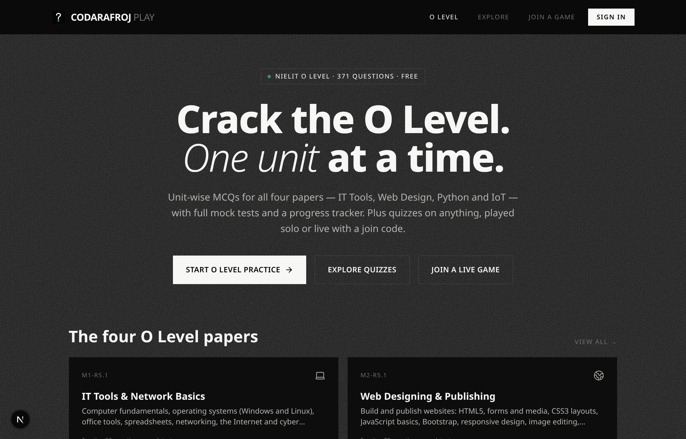
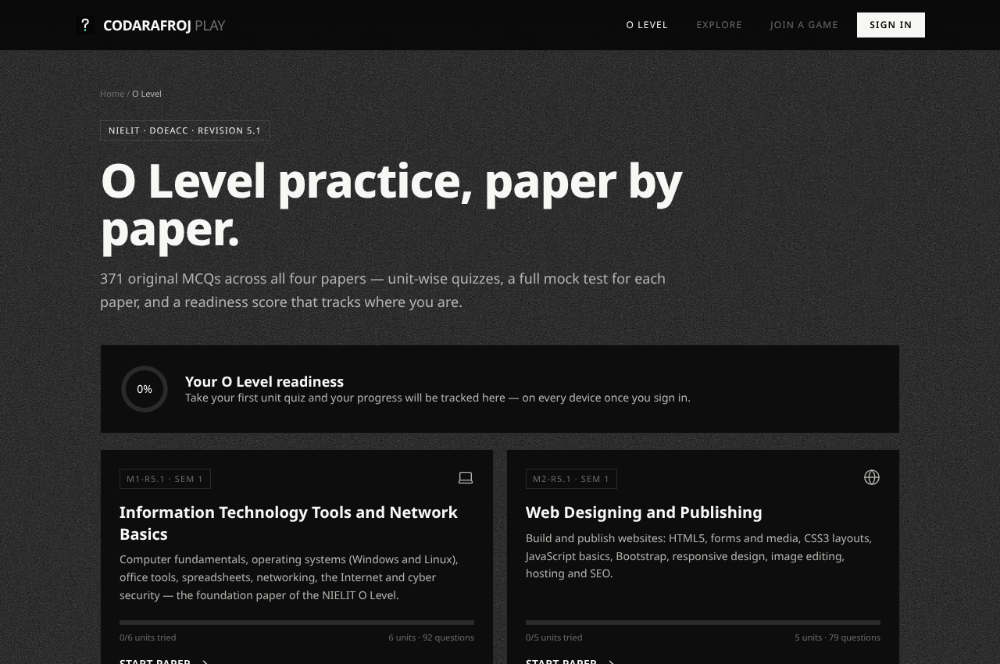
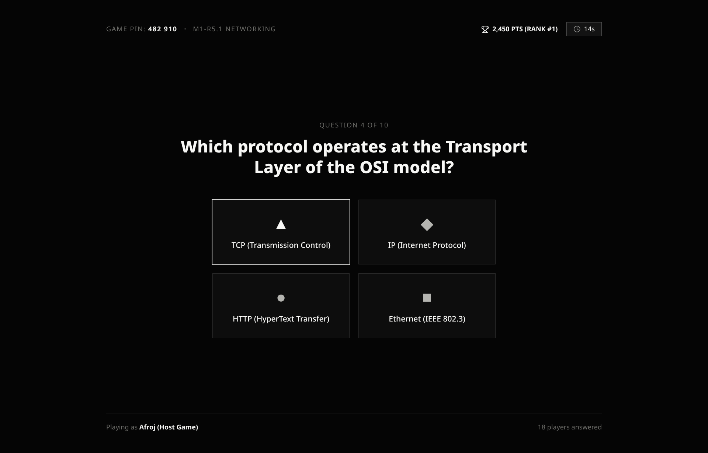
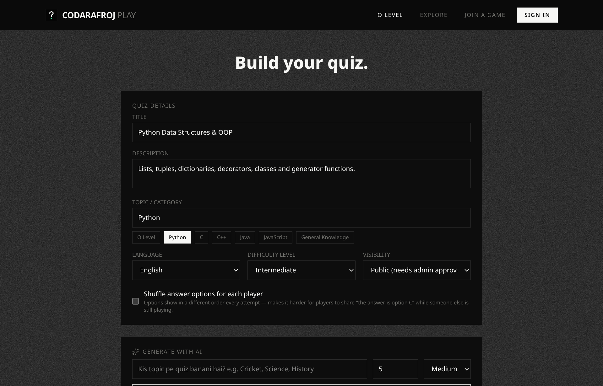
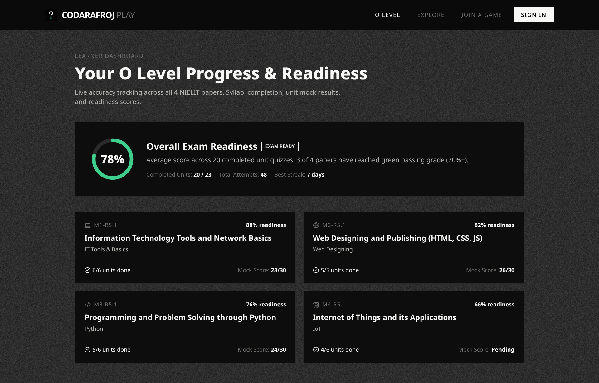

<div align="center">

# Codarafroj Play

**Free NIELIT O Level practice, coding quizzes, and live quiz games with a join code.**

[**Live site: play.coderafroj.me**](https://play.coderafroj.me)

[](LICENSE)
[](https://nextjs.org)
[](https://firebase.google.com)
[](CONTRIBUTING.md)



</div>

---

## Why this exists

Good O Level practice material is scattered across PDFs and ad-filled sites. Codarafroj Play puts it in one free place: unit-wise MCQs for all four papers, full mock tests, and progress tracking. Anyone can also build their own quiz and host it live, like a classroom quiz night.

## Features

**For O Level students**
- 4 papers, 24 unit quizzes, 4 full mock tests, **371 MCQs**
  - M1-R5.1 IT Tools & Network Basics
  - M2-R5.1 Web Designing & Publishing
  - M3-R5.1 Python Programming
  - M4-R5.1 Internet of Things
- Progress tracking with best scores, attempts and a readiness meter, synced across devices
- Options reshuffle and every question is timed, so you learn the answer, not its position

**For everyone**
- Coding quizzes in Python, C, C++ and Java, plus General Knowledge
- **Live games**: host a real-time quiz, players join with a 6-digit code (no account needed), ending in a podium
- **Solo links**: share a quiz anyone can play at their own pace
- **Create quizzes** in any language, optionally generated with AI
- Daily quiz, remix a quiz, score cards, and a mobile-first PWA layout
- Fair-play checks: copy and tab-switch detection

**For admins**
- Learner insights, an idempotent O Level importer, and a duplicate cleaner

## Screenshots

| O Level papers | Live game |
| :---: | :---: |
|  |  |
| **Quiz builder** | **Progress tracking** |
|  |  |

## Tech stack

- **Framework:** [Next.js](https://nextjs.org) (App Router), React, TypeScript
- **Styling and motion:** Tailwind CSS 4, Framer Motion, Lucide icons
- **Backend:** Firebase Authentication and Cloud Firestore (security rules in `firestore.rules`)
- **AI quiz generation:** Groq, Gemini and OpenRouter with automatic fallback (all optional)
- **Hosting:** Vercel or Firebase Hosting

## Getting started

### Prerequisites

- Node.js 20 or newer
- A free [Firebase](https://console.firebase.google.com) project

### 1. Clone and install

```bash
git clone https://github.com/coderafroj/quiz.git
cd quiz
npm install
```

### 2. Set up Firebase

1. Create a Firebase project and add a **Web app**.
2. **Authentication** → Sign-in method → enable **Email/Password** (and **Google** if you want Google sign-in).
3. **Firestore Database** → Create database → production mode → choose a region near your users.
4. Copy your own project ID into `.firebaserc`.
5. Deploy the security rules:

```bash
npx firebase-tools login
npx firebase-tools deploy --only firestore:rules
```

### 3. Configure environment variables

```bash
cp .env.example .env.local
```

Fill in the `NEXT_PUBLIC_FIREBASE_*` values from your Firebase web app. The AI keys are optional: set at least one of `GROQ_API_KEY`, `GEMINI_API_KEY` or `OPENROUTER_API_KEY` to enable AI quiz generation.

### 4. Make yourself admin

Change the email list in **both** `lib/users.ts` (`OWNER_EMAILS`) and `firestore.rules` (`isVerifiedOwner`) to your own email, then redeploy the rules. The first time you sign up with that verified email you become an admin.

### 5. Run

```bash
npm run dev
```

Open <http://localhost:3000>, then visit `/admin/import` once to import the O Level quizzes (safe to run again, it never duplicates).

## Scripts

| Command | What it does |
| --- | --- |
| `npm run dev` | Start the dev server |
| `npm run build` | Production build |
| `npm run start` | Run the production build |
| `npm run lint` | Lint the code |

## Project structure

```
app/
  page.tsx                 Landing page
  olevel/                  O Level papers and unit pages
  explore/                 Browse public quizzes
  play/[quizId]/           Solo play
  join/, live/[code]/      Join and play a live game
  host/[code]/             Host control panel
  dashboard/               Create, edit and view results for your quizzes
  admin/                   Admin overview, importer, duplicate cleaner
  api/generate-quiz/       AI quiz generation (sign-in required, rate limited)
components/                UI components
context/                   Auth context
lib/
  olevel/                  O Level question bank (m1 to m4)
  sessions.ts              Live game engine
  progress.ts              Per-learner progress
  quizzes.ts, attempts.ts  Quiz CRUD and solo leaderboard
  useAntiCheat.ts          Fair-play detection
firestore.rules            Security rules
```

## Contributing

Contributions are welcome, and **adding or fixing O Level questions is the easiest way to start**. Read [CONTRIBUTING.md](CONTRIBUTING.md), then pick an issue labeled `good first issue`.

## Known trade-offs

- Live-game players do not need an account, so scores inside a game are range-checked by the rules but not tied to a verified identity. Fine for casual and classroom use.
- The interface is in English. Only the quiz content can be in any language.
- Questions are text-only for now (no images).

See [SECURITY.md](SECURITY.md) for details and how to report vulnerabilities.

## Roadmap

- [ ] More O Level questions with explanations
- [ ] Hindi interface and Hindi question sets
- [ ] Images in questions
- [ ] Server-side scoring for live games
- [ ] Public API for quiz data

## License

Released under the [MIT License](LICENSE). Quiz content in `lib/olevel` is original work written for this project.

## Author

Built by [Codarafroj](https://coderafroj.me). If this helps you, a ⭐ on the repo means a lot.
